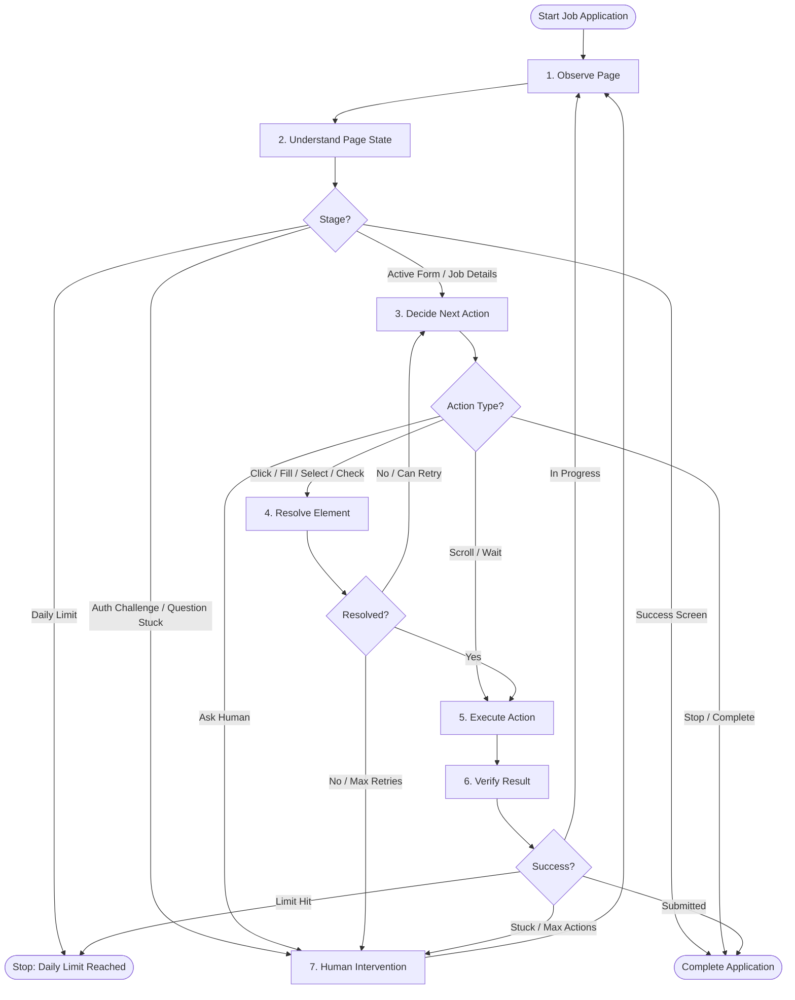

# 🤖 Zozo-bot — AI-Agentic LinkedIn Easy Apply Automation

Zozo-bot is an intelligent, resilient browser automation system powered by **LangGraph, Playwright, and Large Language Models (LLMs)**. It replaces fragile, hardcoded Playwright CSS selectors (`.jobs-apply-button`, `button[aria-label="..."]`, fixed sequence assumptions) with an adaptive AI agent that observes the live DOM, understands the application state, resolves targets using semantic grounding and accessibility features, and verifies every interaction.

---

## 🌟 Key Capabilities

- 🧠 **Zero Brittle Selectors**: The agent does not rely on hardcoded class names or dynamic element IDs. Targets are resolved dynamically through an 8-stage priority resolver (accessible roles/names, associated labels, placeholders, stable attributes, and visual context).
- 🔄 **LangGraph StateGraph Workflow**: Structured execution loop (`Observe Page` ➔ `Understand Page` ➔ `Decide Next Action` ➔ `Resolve Element` ➔ `Execute Action` ➔ `Verify Result` ➔ `Loop/Complete/Intervene`) with memory checkpointing.
- ⚡ **Token-Efficient DOM Extraction**: Uses a single-turn JavaScript evaluation to batch-extract only visible interactive elements, form fields, and modal containers, preventing full-DOM token explosion.
- 👤 **Centralized Candidate Profile**: Structured data loader (`data/candidate_profile.yaml` or `data/resume.txt`) supplying ground-truth qualifications without inventing candidate details.
- 🛑 **Daily Submission Limit Detection**: Native recognition of LinkedIn rate limits (`"We limit daily submissions to maintain quality and prevent bots"`) with automatic shutdown to protect account safety.
- 🤝 **Human-in-the-Loop**: Checkpointed pause and resume for ambiguous questions, 2FA/CAPTCHA challenges, or final submission approvals.
- 🔗 **Hiring Team Outreach**: Automated connection requests to job posters and recruiters post-application (configurable).
- ⚙️ **Configurable LLM Provider**: First-class support for **Groq** and **OpenAI**, with independent model selection for planning vs. observation.

---

## 🗂️ Project Structure

```text
Zozo-bot/
├── main.py                          # Application entry point
├── requirements.txt                 # Python dependencies
├── sample.env / .env.example        # Environment configuration templates
├── data/
│   ├── candidate_profile.yaml       # Structured candidate profile (YAML)
│   ├── resume.txt                   # Plaintext candidate resume (fallback)
│   ├── system_prompt.txt            # Answering rules & constraints
│   ├── human_prompt.txt             # Question answering template
│   ├── job_applications.md          # Recruiter outreach tracking log
│   ├── session_tracker.json         # Session duplicate prevention log
│   └── screenshots/                 # Diagnostic & error screenshots
│
├── app/
│   ├── agent/                       # LangGraph Agent Core
│   │   ├── graph.py                 # StateGraph builder and execution runner
│   │   ├── state.py                 # TypedDict AgentState definition
│   │   ├── nodes.py                 # observe, understand, decide, resolve, execute, verify nodes
│   │   ├── decisions.py             # Conditional routing functions for edges
│   │   ├── prompts.py               # Prompt templates (understanding, decision, Q&A)
│   │   ├── models.py                # Pydantic models (PageObservation, AgentAction, etc.)
│   │   └── checkpoints.py           # MemorySaver checkpointer setup
│   │
│   ├── browser/                     # Playwright & DOM Layer
│   │   ├── observer.py              # Efficient single-turn DOM extractor (PageObserver)
│   │   ├── element_resolver.py      # Semantic & accessible element resolution engine
│   │   ├── playwright_tools.py      # Robust Playwright action execution tools
│   │   ├── page_context.py          # Page stabilization, fingerprints, and caching
│   │   └── screenshots.py           # Diagnostic screenshot utility
│   │
│   ├── linkedin/                    # LinkedIn Automation & Workflow
│   │   ├── easy_apply_workflow.py   # Outer pagination & job loop orchestrator
│   │   ├── page_classifier.py       # Fast heuristic page classification
│   │   ├── application_state.py     # ApplicationTracker & duplicate prevention
│   │   └── daily_limit.py           # Daily submission limit detection & exceptions
│   │
│   ├── profile/                     # Candidate Data
│   │   ├── candidate_profile.py     # Pydantic CandidateProfile & WorkAuthorization models
│   │   └── profile_loader.py        # YAML loader & resume text parser
│   │
│   ├── models/                      # LLM Integrations
│   │   └── llm_factory.py           # Factory supporting Groq, OpenAI, and compatible APIs
│   │
│   ├── human/                       # Human-in-the-Loop
│   │   └── intervention.py          # Interactive CLI prompt and formatting
│   │
│   ├── bot/                         # Reusable Legacy Modules
│   │   ├── handle_login.py          # Session authentication & 2FA handling
│   │   └── connect_hiring_team.py   # Recruiter connection request outreach
│   │
│   ├── config/                      # Configuration & Safety
│   │   ├── config.py                # Environment variable loading & validation
│   │   └── excluded_job.py          # Company & title keyword exclusion filters
│   │
│   └── utils/
│       ├── logging.py               # Structured emoji logger & file handler
│       ├── human.py                 # Human delays & typing simulation
│       └── file_loader.py           # File reader utilities
│
└── tests/                           # Pytest Test Suite (24 tests)
    ├── conftest.py                  # Shared fixtures & mock locator factory
    ├── test_agent_graph.py          # LangGraph graph building & node execution tests
    ├── test_observer.py             # PageObserver extraction & error tests
    ├── test_element_resolver.py     # Dynamic element resolution & disambiguation tests
    ├── test_easy_apply.py           # Application tracker & page classifier tests
    ├── test_daily_limit.py          # Daily limit visibility & exception tests
    ├── test_models.py               # Pydantic schema validation tests
    └── fixtures/                    # Mock HTML test fixtures (forms, modals, limits)
```

---

## 🔁 How the Agent Works

The application operates as a closed-loop perceptual agent orchestrated via LangGraph:



### 1. Observe Page (`app/browser/observer.py`)
- Executes a specialized JavaScript evaluator that inspects the page or active modal.
- Extracts all visible interactive elements (buttons, inputs, dropdowns, radios, checkboxes).
- Captures accessible labels, ARIA attributes, placeholder texts, validation errors, and progress indicators.
- Text content is truncated intelligently to ~4000 characters to minimize token usage.

### 2. Understand Page (`app/agent/nodes.py`)
- Interprets the structured observation using `PageUnderstanding` schema.
- Accurately classifies whether the current view is `job_details`, `application_form`, `resume_page`, `review_page`, or `success_page`.

### 3. Decide Next Action (`app/agent/nodes.py`)
- Considers candidate qualifications, current stage, and the last 5 executed actions.
- Selects the next grounded action conforming to the `AgentAction` schema.
- Automatically handles unchecking the "Follow company" box on review screens.
- Answers application questions based strictly on candidate data.

### 4. Resolve Element (`app/browser/element_resolver.py`)
Locates the Playwright target using strict priority order:
1. Accessible role + accessible name (`page.get_by_role`)
2. Associated label (`page.get_by_label`)
3. Placeholder text (`page.get_by_placeholder`)
4. Stable semantic attributes (`data-test-*`, `aria-label`, `name`)
5. Visible text (`page.get_by_text`)
6. DOM relationships (fieldset/legend context)
- Performs safety checks: element must be visible, enabled, and uniquely disambiguated.

### 5. Execute Action (`app/browser/playwright_tools.py`)
- Executes the action (`click`, `fill`, `select`, `check`, `uncheck`, `scroll`) using human-like mouse movements, variable typing intervals, and bounded timeouts.

### 6. Verify Result (`app/agent/nodes.py`)
- Waits for the DOM to settle and inspects before/after state changes.
- Verifies successful submission before advancing to the next job.

---

## 🛠️ Installation & Setup

### 1. Prerequisites
- Python 3.10+ (tested on Python 3.13)
- Google Chrome or Chromium browser

### 2. Install Dependencies
```bash
python -m venv venv
# Windows:
venv\Scripts\activate
# Linux/macOS:
source venv/bin/activate

pip install -r requirements.txt
playwright install chromium
```

### 3. Configure Environment Variables
Copy `sample.env` to `.env`:
```bash
cp sample.env .env
```

Configure your credentials and LLM keys in `.env`:
```env
# LinkedIn Credentials
LINKEDIN_EMAIL="your_email@example.com"
LINKEDIN_PASSWORD="your_password"
LINKEDIN_JOB_LINK="https://www.linkedin.com/jobs/search/?keywords=software%20engineer&f_TPR=r86400&f_AL=true&sortBy=DD"
PHONE_NUMBER="your_phone_number"

# LLM Configuration (Groq or OpenAI)
LLM_PROVIDER="groq"
LLM_MODEL="openai/gpt-oss-120b"
GROQ_API_KEY="your_groq_api_key"

# Agent Safety
MAX_ACTIONS_PER_APPLICATION=50
MAX_RETRIES=3
HUMAN_APPROVAL_BEFORE_SUBMIT="false"
SCREENSHOT_ON_ERROR="true"

# Hiring Team Outreach
AUTO_CONNECT_HIRING_TEAM="false"
```

### 4. Configure Candidate Profile
Edit `data/candidate_profile.yaml` with your actual skills, experience, and default answers. If this file is omitted, the bot automatically extracts your profile from `data/resume.txt`.

---

## 🚀 Running the Application

Start the agentic bot:
```bash
python main.py
```

The bot will:
1. Open a Chromium browser session with persistent cookies in `data/session`.
2. Verify LinkedIn login state (pausing for 2FA if required).
3. Open your job search query URL.
4. Iterate through job cards, skipping excluded or already-applied postings.
5. Invoke the LangGraph agent to navigate Easy Apply forms, answer questions, and submit.
6. Record application logs in `data/session_tracker.json` and optionally send connection notes to recruiters.

---

## 🧪 Running the Test Suite

The unit and integration test suite uses mocked Playwright locators and HTML fixtures—no real LinkedIn credentials or active network connections are required:

```bash
pytest tests/ -v
```

### Test Coverage Highlights:
- ✅ Dynamic Easy Apply identification despite arbitrary CSS classes
- ✅ Form field extraction and dropdown option parsing
- ✅ Checkbox and radio button identification
- ✅ Multi-step state machine routing (understand ➔ decide ➔ resolve ➔ execute ➔ verify)
- ✅ Daily submission limit detection and immediate exit
- ✅ Human intervention checkpointing and response resumption
- ✅ Duplicate application prevention via `ApplicationTracker`
- ✅ Pydantic schema validation for actions and observations
